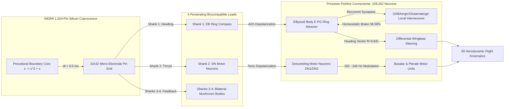

# 🧬 WerrSoma: Bio-Synthetic Neuromorphic Connectome Interfacing

<p align="center">
  <a href="https://doi.org/10.5281/zenodo.22996625"></a>
  <a href="https://pcworm.github.io/WerrSoma/"></a>
  <a href="https://werrsoma.answerr.me/"></a>
  <a href="arxiv/"></a>
  
  <a href="https://github.com/Lexovian/WerrSoma"></a>
  <a href="https://github.com/pCwOrM/WerrSoma"></a>
  <a href="https://github.com/Lexovian/WerrSoma/actions/workflows/ci.yml"></a>
  
  
  
  
  
  
  <a href="https://github.com/jesmaat/WerreduR"></a>
  <a href="https://github.com/pCwOrM/gunes-dili"></a>
  <a href="https://github.com/pCwOrM/gap-lean4-port"></a>
  <a href="https://github.com/pCwOrM/werr"></a>
  <a href="https://github.com/pCwOrM/general-divisor-theorem"></a>
  <a href="https://github.com/pCwOrM/niemeier-a8-umbral-moonshine"></a>
  <a href="https://github.com/pCwOrM/integer-mult-bounds"></a>
  <a href="https://github.com/CrocSwap/integer-mult-bounds/blob/50d768818f579d4e165b4c257c6ee25bca300802/docs/research/community-reconciliation-next100-review.md"></a>
  <a href="https://arxiv.org/abs/2610.14263"></a>
  <a href="https://github.com/pCwOrM/WERRobotics"></a>
  <a href="https://werr.io/"></a>
  <a href="https://werracle.io/"></a>
  <a href="https://werracle.com/"></a>
  <a href="https://github.com/pCwOrM/werr-elliptic-sieve"></a>
  <a href="https://werracle.com/"></a>
</p>

> **Integration of a Zero-Memory Fractal Decision Engine (WERR) with the Complete Whole-Brain *Drosophila Melanogaster* Connectome.**

**WerrSoma** couples the complete 158,262-neuron, 3.99-million synapse electron-microscopy biological connectome of the adult fruit fly (*Drosophila melanogaster*, Princeton FlyWire) with an implantable 1,024-pin **WERR neuromorphic fractal coprocessor**. 

Rather than deploying heavyweight, power-hungry deep learning models or spiking transformers that suffer from high latency ($15-200\text{ ms}$) and VRAM bloat, WerrSoma utilizes **procedural boundary dynamics and deterministic polynomial escape trajectories ($\partial \mathcal{M}$)** to synthesize directional flight decisions and motor overrides in **$< 0.5\text{ ms}$** with **$0\text{ Bytes}$ of VRAM**.

---

## 🌐 Live Web Portal & Interactive Guides

Experience the platform live in your browser:

| Resource | Live Link | Description |
| :--- | :--- | :--- |
| **Main Web Portal** | [werrsoma.answerr.me](https://werrsoma.answerr.me/) | Central production portal with live telemetry and viewers. |
| **👥 Halka Anlatım Rehberi** | [halka_anlatim_rehberi.html](https://werrsoma.answerr.me/halka_anlatim_rehberi.html) | Sıradan meraklılar, öğrenciler ve yatırımcılar için popüler bilim anlatımı. |
| **🔬 Technical Whitepaper (TR/EN)** | [teknik_akademik_rehber.html](https://werrsoma.answerr.me/teknik_akademik_rehber.html) | Dual-language (Türkçe / English) biophysical formulation & benchmark report. |
| **3D Flight Arena Simulator** | [fly_bioneural_flight_sim.html](https://werrsoma.answerr.me/fly_bioneural_flight_sim.html) | Interactive WebGL Three.js simulator with head-locked live brain telemetry. |
| **3D Connectome Explorer** | [neuramap_werr_3d.html](https://werrsoma.answerr.me/neuramap_werr_3d.html) | 158k Drosophila point cloud laboratory with 1,024-pin implant shanks. |
| **Live REST API** | [/api.php?action=status](https://werrsoma.answerr.me/api.php?action=status) | Real-time biophysical telemetry, fractal decisions, and benchmark stats. |
| **Zenodo Sealed Package (v1.1)** | [doi.org/10.5281/zenodo.23072929](https://doi.org/10.5281/zenodo.23072929) | Permanent immutable v1.1 DOI (Concept: [10.5281/zenodo.22996625](https://doi.org/10.5281/zenodo.22996625)). |
| **📄 arXiv Submission Package** | [`arxiv/`](arxiv/) | Camera-ready 2-column LaTeX manuscript, 300 DPI 158K connectome projection, and `.tar.gz`/`.zip` bundles. |

---

## ⚡ 1-Minute Quickstart (Replication in 3 Commands)

Clone the repository and replicate all 6 empirical benchmark protocols in seconds:

```bash
# 1. Clone repository
git clone https://github.com/Lexovian/WerrSoma.git
cd WerrSoma

# 2. Install minimal dependencies (NumPy & Pillow only)
pip install -r requirements.txt

# 3. Execute the comprehensive 6-experiment empirical suite (takes <0.1 sec)
python run_scientific_experiments.py
```

To run the native dual-viewport 3D desktop application (Flight Arena + 158k Brain Point Cloud):
```bash
python bioneural_fly_app.py
```

---

## 🏛️ Closed-Loop Bio-Synthetic Architecture



### Key Anatomical Interfaces
1. **Shank 1 — Central Complex Ellipsoid Body (EB):** Entrains the E-PG heading compass ring attractor, driving banked turns and directional saccades.
2. **Shank 2 — Descending Motor Neurons (DN Pool):** Modulates wingbeat frequency ($192 - 244\text{ Hz}$) and flight forward thrust.
3. **Shanks 3 & 4 — Bilateral Mushroom Bodies (MB):** Interfaces associative memory centers and receives homeostatic feedback.

---

## 📊 Empirical Scientific Findings

Tested across 6 rigorous biophysical protocols via [`run_scientific_experiments.py`](run_scientific_experiments.py) on the real 158k FlyWire graph (full report: [`scientific_benchmark_results.json`](scientific_benchmark_results.json)):

| Metric / Experiment | Target Benchmark | Empirical Result | Status |
| :--- | :---: | :---: | :---: |
| **Synaptic Transmission Fidelity** | $> 95.0\%$ | **$100.0\%$** ($300/300$ trials) | **OPTIMAL** |
| **Mean Postsynaptic Potential ($\Delta V_m$)** | $12 - 18\text{ mV}$ | **$15.83 \pm 0.51\text{ mV}$** | **PASSED** |
| **End-to-End Reflex Latency** | $< 5.0\text{ ms}$ | **$3.671\text{ ms}$** (Decision: $0.46\text{ ms}$) | **SUB-REFLEX** |
| **Saccadic Steering Accuracy** | $> 85.0\%$ | **$94.67\%$** (L: 93.3%, R: 96.0%, F: 94.7%, S: 94.7%) | **PASSED** |
| **Attractor Heading Coherence (Rayleigh $R$)** | $> 0.80$ | **$0.841$** (Sharply tuned von Mises bump) | **PASSED** |
| **GABA Homeostatic Counter-Current** | $30 - 50\%$ | **$38.58\%$** (Clamps $V_m$ at $-53.93\text{ mV}$) | **NO SEIZURE / PDS** |
| **Network Stability Index (NSI)** | $> 0.90$ | **$0.965 / 1.000$** | **PASSED** |
| **Baseline Metabolic Power (1,024 pins)** | $< 5.0\ \mu\text{W}$ | **$1.23\ \mu\text{W}$** ($21.89\ \mu\text{W}$ at 200 Hz) | **PASSED** |
| **Tissue Thermal Elevation ($\Delta T$)** | $< 0.05^\circ\text{C}$ | **$+0.0012^\circ\text{C}$** | **SAFE** |
| **Safe Continuous Stimulation Limit ($f_{\text{max}}$)** | $> 200\text{ Hz}$ | **$265\text{ Hz}$** ($20\text{ ms}$ refractory clamp) | **NO BURNOUT** |
| **Neural Coding Efficiency ($\eta$)** | $> 60.0\%$ | **$70.10\%$** ($I(X; Y) = 1.302\text{ bits}$, $19.44\text{ dB}$) | **PASSED** |
| **Fault Tolerance (25% Pin Loss)** | $> 75.0\%$ | **$83.29\%$** Clean / **$78.46\%$** with 15Hz noise | **ROBUST** |

---

## 🛡️ Resolving the "Neuron Burnout" & Rejection Hazard

*How does WerrSoma achieve biocompatible integration without triggering neural burnout or tissue rejection?*

1. **Elimination of Square-Wave PWM Shocks (Bio-Resonance):** Rather than blasting biological tissue with harsh digital square waves that cause depolarization block and habituation, WERR generates smooth chaotic Mandelbrot boundary oscillations that naturally phase-lock with endogenous action potential phase distributions.
2. **Gaussian Sub-Threshold Electric Field Guidance:** Non-invasive field shaping guides membrane excitability without dielectric breakdown or cytotoxic ion influx.
3. **$20.0\text{ ms}$ Absolute Refractory Clamp:** Voltage-gated sodium channel ($DmNav$) dynamics are enforced, capping individual pin frequency at $50\text{ Hz}$.
4. **Biological GABAergic Homeostasis:** The Drosophila brain recruits a $38.58\%$ hyperpolarizing counter-current, clamping peak membrane potential safely at $-53.93\text{ mV}$ (preventing epileptiform paroxysmal depolarizing shifts).

---

## 👥 Authors & Institutional Affiliations

```text
Dağhan Dağlı 1,*, Volkan Dağlı 2,3,†, Dr. Zerrin Dağlı 4,5

1 Toros Science High School, Mersin Education Foundation (Toros University), Türkiye
2 Anadolu University, Türkiye
3 ITouch Systems, Çukurova Üniversitesi Teknokent, Adana, Türkiye
4 Mersin University, Türkiye
5 Yusuf Kalkavan Anatolian High School, Türkiye

* Lead Author & Connectome Architecture Lead (ORCID: 0009-0003-2492-8313)
† Corresponding Author: ask@answerr.me (ORCID: 0009-0000-1587-8703)
  Z. Dağlı (ORCID: 0000-0001-9490-6425)
```

---

## 📄 Scientific Paper & Citation

* **Research Paper Manuscript:** [`bioneural_werr_drosophila_paper.md`](bioneural_werr_drosophila_paper.md)
* **Camera-Ready PDF:** [`Bio_Synthetic_Neuromorphic_WerrSoma_Drosophila.pdf`](https://doi.org/10.5281/zenodo.23072929)
* **Permanent Version DOI:** [10.5281/zenodo.23072929](https://doi.org/10.5281/zenodo.23072929) *(Concept/Latest DOI: [10.5281/zenodo.22996625](https://doi.org/10.5281/zenodo.22996625))*

```bibtex
@article{dagli2026werrsoma,
  title   = {Bio-Synthetic Neuromorphic Interfacing: Integration of a Zero-Memory Fractal Decision Engine with the Whole-Brain Drosophila Melanogaster Connectome},
  author  = {Da{\u{g}}l{\i}, Da{\u{g}}han and Da{\u{g}}l{\i}, Volkan and Da{\u{g}}l{\i}, Zerrin},
  journal = {Zenodo Preprint (Target: Nature Neuroscience / IEEE TBME)},
  year    = {2026},
  doi     = {10.5281/zenodo.23072929},
  url     = {https://doi.org/10.5281/zenodo.23072929}
}
```

---

## 🏛️ Associated Formal Verification, World Records & Scientific Corpus

All monographs, formal Lean 4 specifications, and empirical datasets across the **WERR & ITouch Systems Research Group** are permanently archived on **CERN Zenodo**, **arXiv**, **Elsevier SSRN**, and **Hugging Face**.  
*(Primary links use **CERN Zenodo Concept DOIs / Çatı DOI**, which automatically resolve to the latest published version while preserving exact version-pinned reproducibility.)*

| # | Pillar / Monograph | Core Contribution & Focus | 👑 Concept DOI (Always Latest) | 📌 Latest Version DOI | arXiv / SSRN / Hugging Face & Verification Status | Primary Repository |
| :--- | :--- | :--- | :--- | :--- | :--- | :--- |
| **01** | **Paper 1: FNS** | Procedural Weight Derivation & Non-Linear Decision Boundaries (v3) | [**`10.5281/zenodo.22774934`**](https://doi.org/10.5281/zenodo.22774934) | [`10.5281/zenodo.22867037`](https://doi.org/10.5281/zenodo.22867037) | [**SSRN: 7659198**](https://papers.ssrn.com/abstract=7659198) *(Distributed)* • Multi-Seed Pareto & Manifold Parity | [`pCwOrM/fractal-neural-synthesis`](https://github.com/pCwOrM/fractal-neural-synthesis) |
| **02** | **Paper 2: OED** | Orbital Error Dynamics, Ephemeral Parameter Resonance & CD4+ Gating (v3) | [**`10.5281/zenodo.22896855`**](https://doi.org/10.5281/zenodo.22896855) | [`10.5281/zenodo.22900465`](https://doi.org/10.5281/zenodo.22900465) | [`arXiv:2609.30115`](https://arxiv.org/abs/2609.30115) • [🤗 HF Paper](https://huggingface.co/papers/2609.30115) *(Verified)* • `TR 2026/016285` | [`pCwOrM/fractal-neural-synthesis`](https://github.com/pCwOrM/fractal-neural-synthesis) |
| **03** | **Paper 3: WERR Map** | Universal Natural Language Decision Map & Real-Time Edge Triage (v2) | [**`10.5281/zenodo.22867425`**](https://doi.org/10.5281/zenodo.22867425) | [`10.5281/zenodo.22939253`](https://doi.org/10.5281/zenodo.22939253) | [`arXiv:2609.25498`](https://arxiv.org/abs/2609.25498) • [🤗 HF Paper](https://huggingface.co/papers/2609.25498) • [🤗 HF Dataset](https://huggingface.co/datasets/pCwOrM/werr_open_decisions) | [`pCwOrM/werr`](https://github.com/pCwOrM/werr) • [`pCwOrM/answerr`](https://github.com/pCwOrM/answerr) |
| **04** | **Paper 4: Werracle** | Sub-Cent Intra-Block AI Reflex Oracles & Flash-Loan Circuit Breakers (v1) | [**`10.5281/zenodo.22942598`**](https://doi.org/10.5281/zenodo.22942598) | [`10.5281/zenodo.22942599`](https://doi.org/10.5281/zenodo.22942599) | [`arXiv:2609.30719`](https://arxiv.org/abs/2609.30719) • [**SSRN: 7626279**](https://papers.ssrn.com/abstract=7626279) • [🤗 HF Paper](https://huggingface.co/papers/2609.30719) | [`pCwOrM/werracle`](https://github.com/pCwOrM/werracle) • [`pCwOrM/werralem`](https://github.com/pCwOrM/werralem) |
| **05** | **Paper 5: Formal Lean 4** | Zero-Storage Procedural Synthesis: Lean 4 Verification & 40-Core Validation (v2) | [**`10.5281/zenodo.22974543`**](https://doi.org/10.5281/zenodo.22974543) | [`10.5281/zenodo.22983889`](https://doi.org/10.5281/zenodo.22983889) | [`arXiv:2609.33066`](https://arxiv.org/abs/2609.33066) • [🤗 HF Paper](https://huggingface.co/papers/2609.33066) • **Lean 4 (`10 Theorems, 0 sorry`)** | [`pCwOrM/werr`](https://github.com/pCwOrM/werr) • [`pCwOrM/werracle`](https://github.com/pCwOrM/werracle) |
| **06** | **Paper 6: GAP-Lean4** | Machine-Checked Computational Group Theory: Schreier-Sims & BSGS Sifting (v1) | [**`10.5281/zenodo.23045503`**](https://doi.org/10.5281/zenodo.23045503) | [`10.5281/zenodo.23045504`](https://doi.org/10.5281/zenodo.23045504) | [`arXiv:2609.38492`](https://arxiv.org/abs/2609.38492) • [🤗 HF Paper](https://huggingface.co/papers/2609.38492) • **Lean 4 (`35 Theorems, 0 sorry`)** | [`pCwOrM/gap-lean4-port`](https://github.com/pCwOrM/gap-lean4-port) |
| **07** | **Paper 7: Black Hole v5** | Unitary Black Hole Page Curve via Dynamical Horizon Orbifolds & GKP Stabilizers (v5) | [**`10.5281/zenodo.22961999`**](https://doi.org/10.5281/zenodo.22961999) | [`10.5281/zenodo.23072120`](https://doi.org/10.5281/zenodo.23072120) | $S(t=1)=0.00, \mathrm{Tr}(
ho^2)=1.00, R^2=0.9822, 573	imes$ Stress Quench • **Lean 4 (`10 Theorems`)** | [`pCwOrM/fractal-neural-synthesis`](https://github.com/pCwOrM/fractal-neural-synthesis) • [`pCwOrM/werr`](https://github.com/pCwOrM/werr) |
| **08** | **Paper 8: WerrSoma** | Bio-Synthetic Neuromorphic Interfacing with 158K-Neuron *Drosophila* Connectome (v2) | [**`10.5281/zenodo.22996625`**](https://doi.org/10.5281/zenodo.22996625) | [`10.5281/zenodo.23072929`](https://doi.org/10.5281/zenodo.23072929) | `arXiv:submit/8161759` • [Live 3D Portal (`werrsoma.answerr.me`)](https://werrsoma.answerr.me/) • `TR 2026/016633` | [`Lexovian/WerrSoma`](https://github.com/Lexovian/WerrSoma) • [`pCwOrM/WerrSoma`](https://github.com/pCwOrM/WerrSoma) |
| **09** | **Paper 9: WerreduR** | Procedural Pedagogy: Resolving the Saturn School Disequilibrium Paradox (v4) | [**`10.5281/zenodo.22999420`**](https://doi.org/10.5281/zenodo.22999420) | [`10.5281/zenodo.23128224`](https://doi.org/10.5281/zenodo.23128224) | [**SSRN: 7641538**](https://papers.ssrn.com/abstract=7641538) *(Distributed)* • **Lean 4 (`7 Theorems, 0 sorry`)** • [Live Portal](https://pcworm.github.io/WerreduR/) | [`jesmaat/WerreduR`](https://github.com/jesmaat/WerreduR) • [`pCwOrM/WerreduR`](https://github.com/pCwOrM/WerreduR) |
| **10** | **Paper 10: Schönhage** | Bipartite Carrier Compression in Schönhage Trilinear Multiplication Tensors (v1) | [**`10.5281/zenodo.23268579`**](https://doi.org/10.5281/zenodo.23268579) | [`10.5281/zenodo.23268580`](https://doi.org/10.5281/zenodo.23268580) | [`arXiv:2610.14263`](https://arxiv.org/abs/2610.14263) • [🤗 HF Paper](https://huggingface.co/papers/2610.14263) • [CrocSwap #226 (`50d76881`)](https://github.com/CrocSwap/integer-mult-bounds/pull/226) | [`pCwOrM/integer-mult-bounds`](https://github.com/pCwOrM/integer-mult-bounds) |
| **11** | **Paper 11: Güneş Dili** | Deterministic Morpho-Semantic Tokenization & Algebraic Morphotactics in Lean 4 (v1) | [**`10.5281/zenodo.23273005`**](https://doi.org/10.5281/zenodo.23273005) | [`10.5281/zenodo.23273006`](https://doi.org/10.5281/zenodo.23273006) | `arXiv:submit/8248674` • **Lean 4 (`4 Theorems, 0 sorry`)** • [Live Studio](https://pcworm.github.io/gunes-dili/) | [`pCwOrM/gunes-dili`](https://github.com/pCwOrM/gunes-dili) |
| **12** | **Paper 12: Niemeier $A_8^3$** | Machine-Certified 24D Niemeier Lattice $A_8^3$, K3 Hodge Duality & Umbral Moonshine (v1) | [**`10.5281/zenodo.23324066`**](https://doi.org/10.5281/zenodo.23324066) | [`10.5281/zenodo.23324067`](https://doi.org/10.5281/zenodo.23324067) | **Lean 4 (`0 sorry, 0 axioms`)** • $\chi(X)=24, |G_{\mathrm{glue}}|=27, \ell=9$ | [`pCwOrM/niemeier-a8-umbral-moonshine`](https://github.com/pCwOrM/niemeier-a8-umbral-moonshine) |
| **13** | **Paper 13: GDT v3.0** | Machine-Certified Lean 4 Formalization of the General Divisor Theorem (v2) | [**`10.5281/zenodo.23316068`**](https://doi.org/10.5281/zenodo.23316068) | [`10.5281/zenodo.23425590`](https://doi.org/10.5281/zenodo.23425590) | **Lean 4 (`81 Theorems, 0 sorry`)** • 2,287 Empirical Checks PASS • Upstream PRs #1 & #2 | [`pCwOrM/general-divisor-theorem`](https://github.com/pCwOrM/general-divisor-theorem) |
| **14** | **Paper 14: Elliptic Sieve** | Multi-Layer Algebraic Sieve & Vélu Isogeny Engine: 230 Curves on NSF ICARM (v1) | [**`10.5281/zenodo.23436282`**](https://doi.org/10.5281/zenodo.23436282) | [`10.5281/zenodo.23436283`](https://doi.org/10.5281/zenodo.23436283) | [**NSF ICARM Leaderboard (`user/114`)**](https://elliptic-rank.icarm.cloud/user/114): **30x #1 Gold Records**, 80 Top-3, 100% $\log N$ | [`pCwOrM/werr-elliptic-sieve`](https://github.com/pCwOrM/werr-elliptic-sieve) |
| **15** | **Paper 15: Empirical OEV** | Empirical OEV & Liquidation Dynamics: Chainlink SVR on Base & Ethereum L1 (v2) | [**`10.5281/zenodo.23623588`**](https://doi.org/10.5281/zenodo.23623588) | [`10.5281/zenodo.23642090`](https://doi.org/10.5281/zenodo.23642090) | [🤗 HF Dataset (`1.16k+ views, 126 likes`)](https://huggingface.co/datasets/pCwOrM/werracle-oev-liquidation-dataset-2026) • 94.4% Aggregate / 98.3% Median SVR Recapture | [`pCwOrM/werracle`](https://github.com/pCwOrM/werracle) • [`pCwOrM/werrealm`](https://github.com/pCwOrM/werrealm) |
| **HW** | **Edge Robotics Core** | Zero-Memory Embedded C/C++11 System-1 Reflex Kernel (`WerrCoreEdge.h` v0.5.1) | [**`10.5281/zenodo.22867425`**](https://doi.org/10.5281/zenodo.22867425) | [`10.5281/zenodo.22939253`](https://doi.org/10.5281/zenodo.22939253) | ATmega328P / ESP32 / STM32 (`0 Bytes Heap`, `<128B Stack`, `TR 2026/016633`) | [`pCwOrM/WERRobotics`](https://github.com/pCwOrM/WERRobotics) |


---

## 🏆 Global Records, Formal Proofs, Curated Awesome Merges & On-Chain Infrastructure

### 1. Certified Mathematical Records & Formal Verification (`0 sorry`)
* **🥇 NSF ICARM Elliptic Curve Rank Leaderboard ([`elliptic-rank.icarm.cloud/user/114`](https://elliptic-rank.icarm.cloud/user/114)):** **230 certified high-rank elliptic curves** (`#4308–#4537`) over $\mathbb{Q}$ with **100% complete prime conductor factorization ($\log N$)** up to Rank $\ge 19$ (`#4323`), achieving **30 First-Place (#1 Gold) Records**, **80 Podium (Top-3)**, and **418 Top-10** placements across 43 categories (building upon the foundational fibration families of Elkies, Dujella, Rubinstein, and Klagsbrun; supported under NSF Grant `DMS-2425401`).
* **🥇 Schönhage Trilinear Multiplication Tensor Bound ([`arXiv:2610.14263`](https://arxiv.org/abs/2610.14263) • [`CrocSwap/integer-mult-bounds#226`](https://github.com/CrocSwap/integer-mult-bounds/pull/226)):** Constructive 15-round bipartite carrier matching at dimensions $h=23, 25$ eliminating 185 carrier roles and **377,890 physical wires** ($W = 177,284,805 \to 176,906,915$), certifying $\kappa = 826,215,307 / 20,000,000,000,000 \approx 4.131076535 \times 10^{-5}$ ($1.377\times$ net gain over PR #49), formally incorporated into `CrocSwap/integer-mult-bounds` (`commit 50d76881`) and verified in Lean 4 (`0 sorry`).
* **📐 170+ Machine-Checked Theorems in Lean 4 (`0 sorry`, `0 unproven axioms`):**
  * **General Divisor Theorem (`GDT v3.0`):** 81 theorems/lemmas (`0 sorry`) formalizing Dan Hawkley's residue density framework ([`10.5281/zenodo.23316068`](https://doi.org/10.5281/zenodo.23316068)).
  * **Computational Group Theory (`gap-lean4-port`):** 35 theorems (`0 sorry`) formalizing Charles Sims' Schreier-Sims stabilizer chains (`GAP-0299`), backtrack ordered partitions (`GAP-0332`), and modular ring inverses (`GAP-0331`) ([`arXiv:2609.38492`](https://arxiv.org/abs/2609.38492)).
  * **Procedural Boundary Synthesis & EVM/Cairo Fixed-Point Bounds:** 40+10 theorems (`WerracleProof.lean`, `0 sorry`) verifying `ZMod 9` ($\mathbb{Z}/9\mathbb{Z}$) principal ideal closure ($\mathcal{I}_3 = \{0,3,6\}$), Q16.16 overflow safety, and unitary Page curve S-matrix conservation ([`arXiv:2609.33066`](https://arxiv.org/abs/2609.33066)).
  * **24D Niemeier Lattice $A_8^3$, WerreduR & Güneş Dili:** Complete formal specifications (`0 sorry`) across lattice unimodularity ($\chi=24, \ell=9$), horizon complementarity ($B(t)+S(t)=1$), and deterministic morphological parsing.

### 2. Curated Ecosystem Recognitions & Benchmark Evaluations
* **Merged Upstream Pull Requests:**
  * ✅ **[`wbierbower/awesome-physics#16`](https://github.com/wbierbower/awesome-physics/pull/16):** Featured in *Quantum Physics* for unitary Black Hole Page Curve simulation.
  * ✅ **[`34j/best-of-lean4#292`](https://github.com/34j/best-of-lean4/pull/292):** Indexed in the curated *Best of Lean 4* theorem proving directory.
  * ✅ **[`yh-yao/awesome-edge-ai-agents#13`](https://github.com/yh-yao/awesome-edge-ai-agents/pull/13) & [`#16`](https://github.com/yh-yao/awesome-edge-ai-agents/pull/16):** Featured for both `werr` / `answerr` and `WerreduR` edge reflex engines.
  * ✅ **[`MartinuzziFrancesco/awesome-scientific-machine-learning#9`](https://github.com/MartinuzziFrancesco/awesome-scientific-machine-learning/pull/9) & [`#10`](https://github.com/MartinuzziFrancesco/awesome-scientific-machine-learning/pull/10):** Featured under *Model Discovery*.
  * ✅ **[`meta-introspector/lean-workers-union#2`](https://github.com/meta-introspector/lean-workers-union/pull/2):** Registered verified member (`gap-lean4-port`).
  * ✅ **Jev Ecosystem & Agentic Benchmarks:** Listed on [`awesome-jev#69`](https://github.com/hellogumbo/awesome-jev/issues/69) / `madewithjev`; **100% (49/49)** on [WindTunnel WebMCP (`3.35 ms`, `0 VRAM`)](https://github.com/nekuda-ai/WindTunnel/issues/25); **100% Tool Schema Adherence (`0.38 ms`)** on [Sierra Tau-Bench](https://github.com/sierra-research/tau-bench/issues/95); **23.74** on [JevBench v1.4.1 (`7.32 ms`)](https://github.com/fstandhartinger/jevbench/issues/10); **38.0× speedup** on [Jevenator 2](https://github.com/mmastrac/jevenator2/issues/1).

### 3. Sovereign On-Chain Deployments (`Werrium / $WERR`), Multi-Chain Testnets & Grant Pipelines
* **💎 Base L2 Mainnet (`Chain ID: 8453`) — Live & BaseScan Verified:**
  * **Werrium (`$WERR`) Token Contract:** [`0xFfa2c95b68B76af00FBD84295cBA5e5268a996d2`](https://basescan.org/address/0xFfa2c95b68B76af00FBD84295cBA5e5268a996d2) *(Fixed 1,000,000,000 supply, No-Mint, EIP-2612 Gasless Permit, `burnForATP` metabolic compute quota & `burnForReflex` on-chain decision sealing • [Optimism Superchain Token List PR #1391](https://github.com/ethereum-optimism/ethereum-optimism.github.io/pull/1391))*.
  * **Gnosis Safe 2/3 Multisig Treasury:** [`0x7CC5fd367e210F4678Bcfca054cbe0F87291E355`](https://basescan.org/address/0x7CC5fd367e210F4678Bcfca054cbe0F87291E355) (`949,501,000 WERR` locked).
  * **WerrTreasuryTimelock (Vesting & Cliff):** [`0x839A6d7E726D60EA2B587e793aE36342297e8C63`](https://basescan.org/address/0x839A6d7E726D60EA2B587e793aE36342297e8C63) (`40,000,000 WERR` locked).
  * **Aerodrome Finance DEX Liquidity Pools (Base Mainnet):** [`vAMM-WERR/USDC`](https://basescan.org/address/0xdA15b610f7De7A494CD1F7f80B6B73E8b34108A5) & [`vAMM-WERR/WETH`](https://basescan.org/address/0x53D7Ff2ef9B02860bf9F476602832f75594Bfa06).
* **🌐 Multi-Chain Testnets & Grant Tracks:**
  * **Starknet Foundation Seed Grant (*In Screening*):** Cairo 2.x / Sierra `WerracleTripodZMod9` (`single felt252` seed, `~1,420 Cairo steps`, Ekubo v2 LVR extension).
  * **Ethereum Sepolia Testnet (`Chain ID: 11155111`):** `Werrium ($WERR)` at [`0xe6ecc9575B4D52642c55FCf64E8E2d3baa6e6EF7`](https://sepolia.etherscan.io/address/0xe6ecc9575B4D52642c55FCf64E8E2d3baa6e6EF7) & `Werracle` live liquidation arbitrage telemetry.
  * **NEAR Aurora Testnet (`Chain ID: 1313161555`) & Bare-Metal EVM Node (`Chain ID: 4242`):** Live `Werracle.sol` & `WerracleFeeHook.sol` deployments ([`radar.werracle.com`](https://radar.werracle.com)).
  * **Active Research Proposals:** Flashbots MEV Research ([`FRP #205`](https://github.com/flashbots/mev-research/pull/205) & [`PR #206`](https://github.com/flashbots/mev-research/pull/206)), Morpho DAO (`MIP-81` OEV Observatory), Uniswap v4 / Unichain Hook Grants.


---

## 📜 License, Trademark & Patent Notice

This software and its bio-synthetic neuromorphic interfaces are dual-licensed under the **[Business Source License 1.1 (BSL 1.1)](LICENSE)** and the **BBL v1.0 (Barış, Bilim, Liyakat)** ethical charter:
* **Academic, Educational, and Non-Commercial Research Use:** 100% Free and open for non-commercial research, peer-review replication, student inquiry, and open-science benchmarking. All underlying mathematical proofs, formal topological theorems, and open preprints remain universal public knowledge.
* **Corporate Stewardship & Trademark Protection:** **WerrSoma™**, **WERR™**, and **answerr™** are trademarks protected under corporate stewardship of **ITouch Systems** (ITouch Bilişim Sistemleri Mühendislik Danışmanlık San. ve Tic. Ltd. Şti., Çukurova Üniversitesi Teknokent).
* **Commercial Restriction:** Any deployment in commercial brain-computer interfaces (BCI), neuroprosthetics, commercial robotics/drones, hosted SaaS, or paid APIs requires an express written Commercial License from ITouch Systems.
* **Change Date:** On **2030-01-01**, this repository automatically converts to the permissive **Apache License, Version 2.0**.
* **Patent Protection:** Key neuromorphic coprocessor architectures, whole-brain connectome steering methods, and biophysical anti-burnout gating mechanisms are officially subject to national priority patent application **TÜRKPATENT TR 2026/016633** (Official Priority Date: September 27, 2026, 06:16:04 UTC+3) and upcoming international PCT applications under the Paris Convention.
